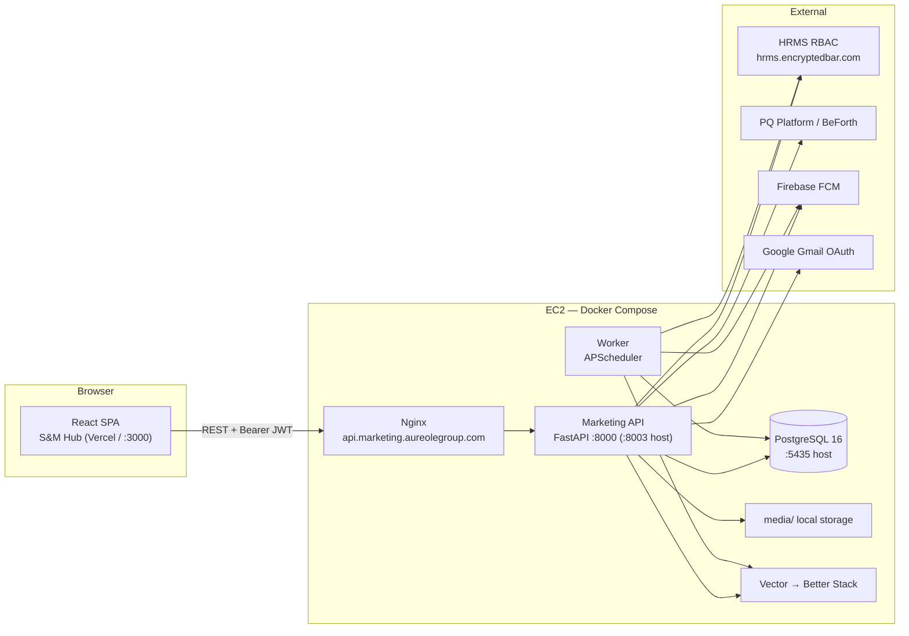
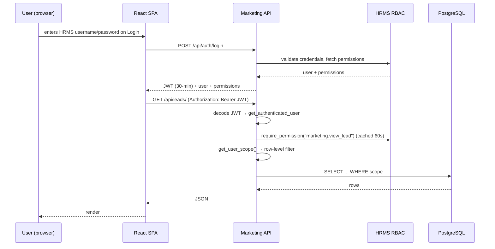
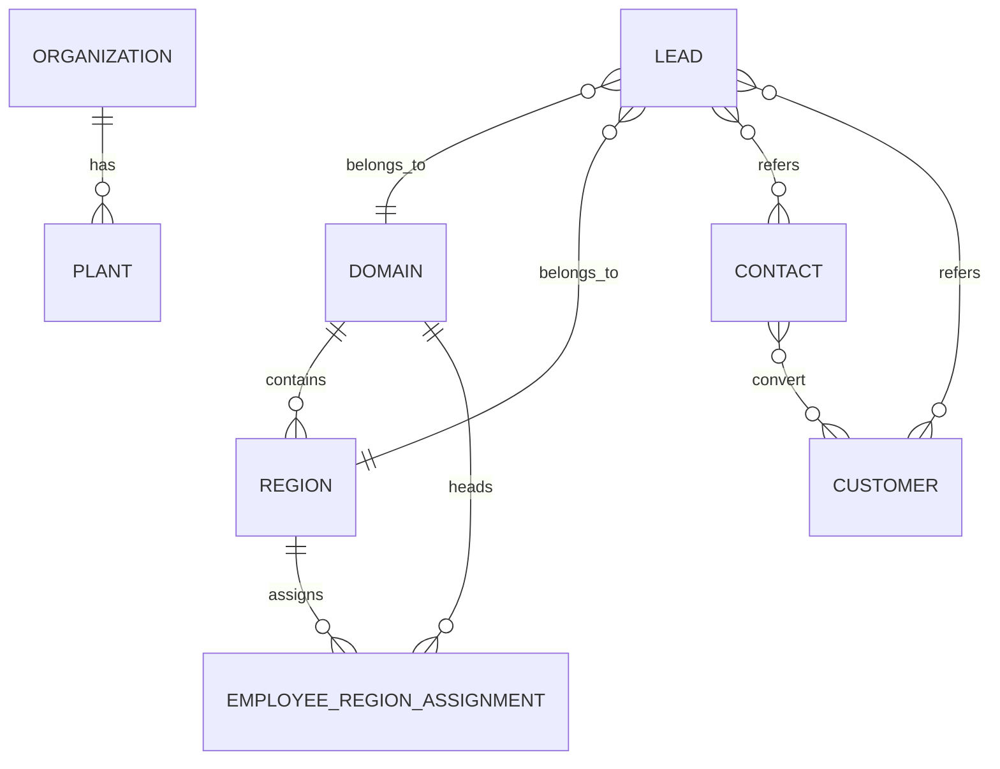
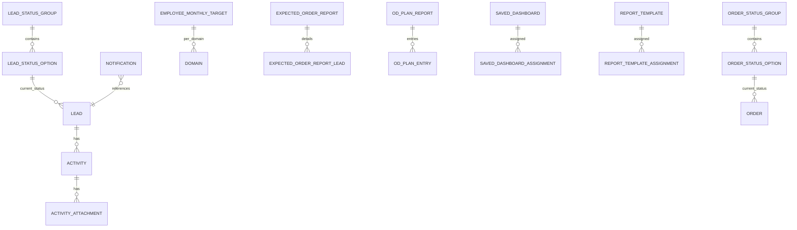
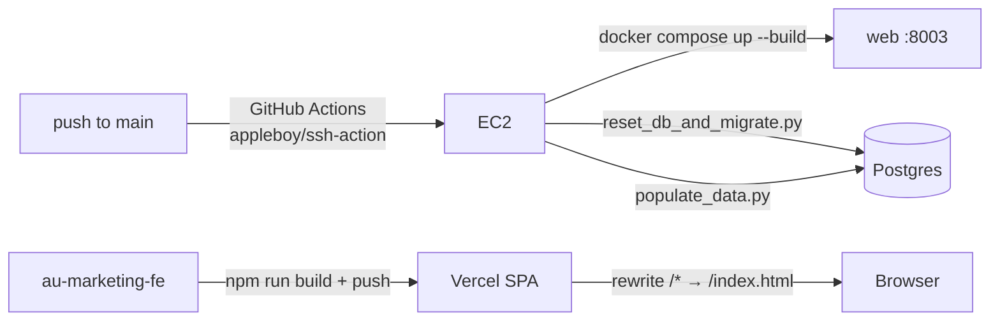

# Architecture

> Diagram-first reference: what connects to what, and why. Each diagram is small on purpose —
> several small ones beat one giant one. For exhaustive detail see the
> [Developer Guide](./developer-guide.md).

## System landscape

Two independent repos, deployed separately:

- **`au-marketing-fe`** — React 19 SPA ("S&M Hub"), served by Vercel (SPA rewrite to `index.html`).
- **`au-marketing-api`** — FastAPI service in Docker Compose (web + worker + Postgres + optional
  vector log sidecar), fronted by Nginx on EC2. Auth and permissions come from an external HRMS
  RBAC service; there is **no BFF** — the SPA talks to the API directly.

## Request / auth flow

Login happens once via HRMS; afterwards every request carries the JWT and the API re-checks
permissions against HRMS with a 60-second in-memory cache.

Key rule: **permission ≠ scope**. The permission dependency gates *whether* you may call the
endpoint; `app/scope.py` decides *which rows* you may see. Visibility Settings
(`past_quarter_access`) is a display-only filter and must never gate a write.

## Data layer

PostgreSQL 16, SQLAlchemy models, heavy JSONB use. Grouped (not exhaustive — 53 models in
`app/models.py`).

### Master data

### Pipeline & reporting

## External integrations

| Integration | Required / optional | Notes |
| --- | --- | --- |
| HRMS RBAC (`hrms.encryptedbar.com/api/rbac`) | **Required** | Login, JWT permissions, employee data; permission checks cached 60s; connectivity probe at startup |
| PostgreSQL 16 | **Required** | Primary store; container `marketing_db`, host port 5435 |
| PQ Platform / BeForth (`crm.beforth.in`, product id 4) | Required | Error tracking middleware + support tickets/feedback (`pq-befu 0.1.0`) |
| APScheduler | Required | Background jobs in the worker: follow-up + event-travel reminders every 1 min |
| Firebase FCM | Optional | Web push via `firebase-admin`; lazy init from service-account path; only HTTPS links |
| Google Gmail OAuth | Optional | "Connect email" — `credentials.json`, `gmail.send` scope, OAuth callback on the API |
| Better Stack (Vector sidecar) | Optional | Docker-log shipping to Better Stack (needs `BETTER_STACK_SOURCE_TOKEN`) |
| Groq (LLM) | Wired-but-inactive | AI SQL/widget generation endpoint is commented out; `GROQ_API_KEY`/`GROQ_MODEL` still configured |
| Object storage (S3) | — | **Does not exist.** README mentions S3/boto3 but attachments live in local `media/` via `app/storage.py` |

## Deployment / infrastructure

- **API deploy:** push to `main` → SSH to EC2 → pull → prune → `compose up --build` → **full DB
  reset + migrate + seed**. ⚠️ This destroys and rebuilds production data on every push.
- **Frontend deploy:** Vercel; `vercel.json` rewrites all paths to `index.html`.
- **Nginx:** serves `api.marketing.aureolegroup.com` (+ `api.marketing.orielgroup.com`), HTTPS,
  100 MB upload limit, proxy to `web:8000`.

## Tech stack

| Area | Stack |
| --- | --- |
| Frontend | React 19, TypeScript 5.7, Vite 6, Tailwind 3.4, Radix UI, react-router 6, Redux Toolkit 2.5 + Zustand 5, Recharts 2.15, Firebase 11 |
| Backend | Python 3.11, FastAPI 0.115, Uvicorn 0.32, SQLAlchemy 2.0, Pydantic 2.9, Alembic 1.14 (scaffold only) |
| Data | PostgreSQL 16, psycopg2, JSONB, startup `create_all` + idempotent ALTERs |
| Jobs | APScheduler (worker container) |
| Infra | Docker Compose, Nginx, GitHub Actions (EC2), Vercel, Better Stack Vector |

## Glossary

| Term | Meaning |
| --- | --- |
| **HRMS RBAC** | External HRMS service that authenticates users and grants `marketing.*` permissions |
| **Permission** | An action gate (e.g. `marketing.view_lead`) checked on every endpoint |
| **Scope** | Row-level visibility filter resolved from the user's role/domain/region |
| **JWT** | HS256 token the API issues after login (30-min expiry), sent as `Authorization: Bearer` |
| **Worker** | The separate Docker container running the APScheduler background jobs |
| **BFF** | Backend-for-frontend — deliberately not used; the SPA calls the API directly |
| **JSONB** | Postgres JSON column type used for flexible config (settings, dashboards, event entries) |
| **Startup ALTERs** | Idempotent schema changes applied in `main.py` on boot (the de-facto migrations) |
