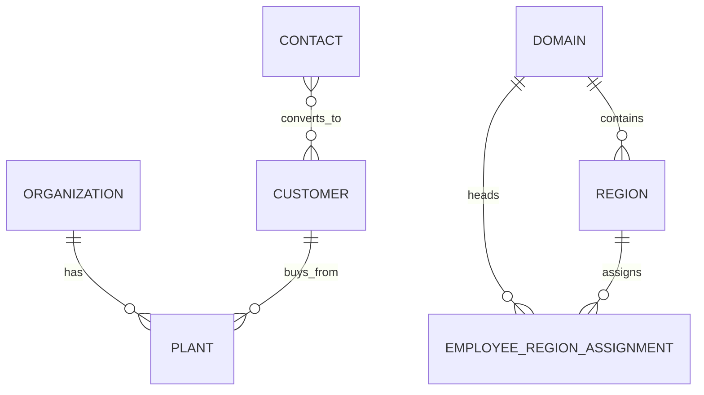
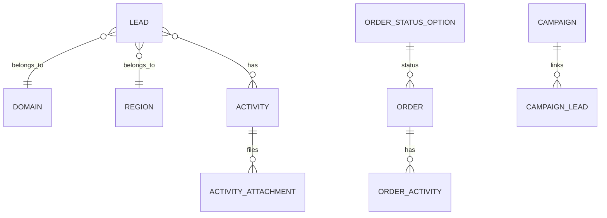

# Inventory Context

## Scope of this document

S&M Hub is a **sales and marketing operations platform**, not a warehouse system. It has **no stock, SKU, warehouse, or ledger module** — a search of the data model (53 SQLAlchemy models) finds no inventory transactions, no reorder levels, and no storage locations.

"Inventory" in S&M Hub therefore means two things:

1. **Commercial master data** — the reusable records everything else points at.
2. **Pipeline records** — the running log of opportunities, quotes, orders, and forecasts.

This page maps both, states what the system intentionally does *not* do, and lists the traps worth knowing.

## 1. Commercial master data

The master data lives under the **Database** screen and the **Domains** screen.

| Entity | What it is | Where managed |
| --- | --- | --- |
| Organization | A company record | Database → Organizations |
| Plant | A site/factory nested under an organization | Open an organization |
| Contact | An individual person | Database → Contacts |
| Customer | A company that buys; created directly or via contact conversion (`Convert to Customer`) | Database → Customers |
| Domain | Sales territory / business line; scopes leads, orders, targets | Domains |
| Region | Geographical area inside a domain, with head/coordinators and assigned employees | Domains |
| Numbering series | Patterns generating automatic lead/order/quotation numbers (e.g. `LEAD-00001`) | Administration → Numbering Series |

**Key relationships**

- A **Plant belongs to an Organization** — it is a site, not a stock location.
- A **Contact can be converted to a Customer**; the original contact remains.
- **Domains contain Regions; regions carry employee assignments** with roles (head, coordinator). This assignment drives row-level visibility everywhere else.

## 2. Pipeline records

The day-to-day "stock in motion" of S&M Hub is commercial, not physical:

| Record | Role | Notes |
| --- | --- | --- |
| Lead | Opportunity being followed up | Status groups/options, type, source; kanban board |
| Activity | Note/call log on a lead | With follow-up date driving reminders |
| Activity attachment | Files on an activity | Can be flagged as a **quotation** (`is_quotation`, quotation number, value); one activity may hold several quotations |
| Order | Confirmed purchase | Mirrors the lead model: statuses, activities, attachments |
| Campaign | Grouping of leads | Links via campaign-lead join |
| DSR entries | Daily sales report logs | Screen at `/dsr` (direct URL only) |

Quotations deserve a special note: there is **no standalone quotation entity**. A quotation is metadata on a lead's activity attachment plus its generated number from the numbering series. The Quotations screen is a read-only view across those attachments, scoped by role.

## 3. Forecast numbers (the closest thing to planning stock)

Reporting holds forward-looking quantities, but they are order forecasts, not stock plans:

| Report | Meaning |
| --- | --- |
| Expected Orders | Per-customer forecast: value + expected date |
| OD Plan (Order Disposition Plan) | Month-by-month planned order values |
| Targets | Monthly targets per employee, per region, per domain |

## 4. What S&M Hub intentionally does NOT have

To avoid false expectations when comparing with ERP-style systems:

| Concept | Present? |
| --- | --- |
| Products / SKUs / variants | No |
| Stock levels per location | No |
| Warehouses / bins | No (a Plant is a site record, not a store) |
| Purchase batches / suppliers / GRN | No |
| Stock transfers, adjustments, wastage | No |
| Reorder levels, low-stock alerts | No |
| Costing / COGS / valuation | No |
| Invoicing / payments | No |

The `/inventory` route in the frontend renders a **static demo page** with no navigation link and no API behind it — it is not a product feature.

## 5. Data-integrity notes for anyone reporting on these records

- **CI resets production data.** The backend deploy pipeline drops and re-seeds the public schema on every push to `main`. Any counts you take are snapshots of the current seed state — see the [Developer Guide](/docs/developer-guide).
- **Attachments live on local disk** (`media/`), not object storage. File references are paths, not URLs.
- **Numbers come from numbering series.** If sequences look wrong, check Administration → Numbering Series before assuming data loss.
- **Scope changes history.** Row-level visibility means two users can legitimately see different totals for the same question — always note whose scope a number was pulled under.
- **`past_quarter_access` is display-only.** Visibility settings never gate writes; they only limit how far back numbers are shown.

## 6. Known limitations / next steps

Honest gaps around the "inventory" edge of the product:

1. **No line items.** Leads, quotations, and orders carry values and attachments but no product/quantity lines. Any itemised quoting would need new models.
2. **Quotations are attachment metadata.** Reporting on quote values works; versioning or approval flows do not exist.
3. **DSR field spec is undocumented.** ⚠️ NEEDS CONFIRMATION: exact DSR fields and cut-off rules.
4. **Demo pages linger.** `/inventory` and `/financials` render static demo content — candidates for removal to avoid confusion.
5. **A true inventory module does not exist.** If the business needs stock control, it is greenfield work (products, locations, transactions, valuation) — not a configuration change.
