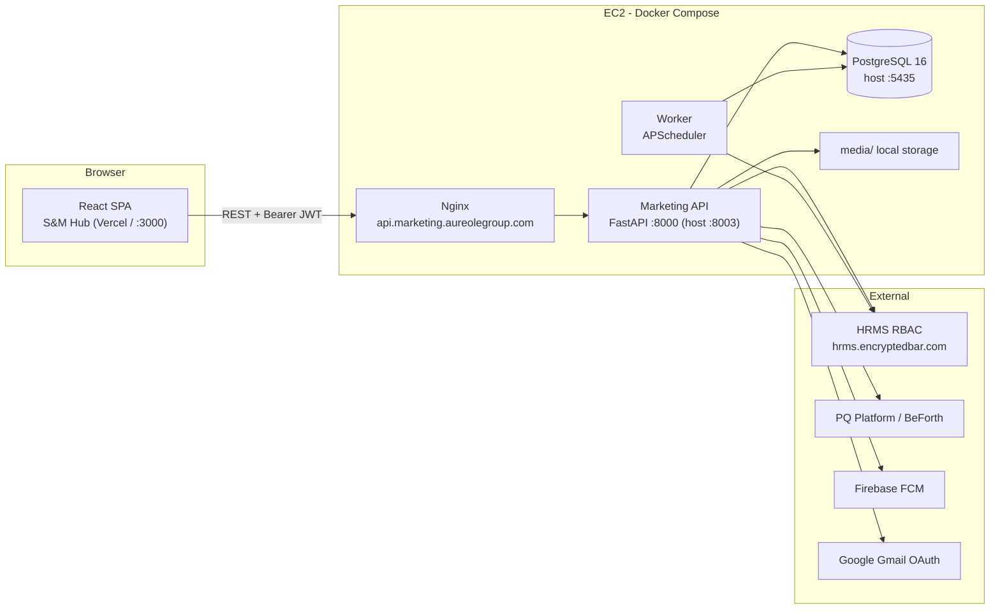

# Platform overview

S&M Hub is delivered as **two independent repositories** deployed separately. There is no monorepo and no BFF — the React SPA talks to the FastAPI API directly over REST with Bearer JWTs.

| Repo | What it is | Deployed on |
| --- | --- | --- |
| [au-marketing-fe](https://github.com/Beforth/au-marketing-fe) | React 19 SPA ("S&M Hub") — every screen, the sidebar, global search, notifications | Vercel (SPA rewrite to `index.html`) |
| [au-marketing-api](https://github.com/Beforth/au-marketing-api) | FastAPI service + PostgreSQL + APScheduler worker in Docker Compose | EC2 via GitHub Actions, fronted by Nginx |

## Tech stack at a glance

### Frontend — au-marketing-fe

| Layer | Technology |
| --- | --- |
| Core | React 19, TypeScript 5.7, Vite 6, Tailwind CSS 3.4, Radix UI |
| Routing / state | react-router-dom 6, Redux Toolkit 2.5, Zustand 5 |
| Charts / animation | Recharts 2.15, Framer Motion 12, Lottie |
| Push | Firebase 11 (FCM web push, optional) |
| Tests | Vitest (smoke only); `npx tsc --noEmit` is the static check |

> ⚠️ Frontend source lives at the **repo root**, not `src/`. `src/` only holds Vitest setup.

### Backend — au-marketing-api

| Layer | Technology |
| --- | --- |
| API | Python 3.11, FastAPI 0.115, Uvicorn 0.32 |
| Data | SQLAlchemy 2.0, Pydantic 2.9, PostgreSQL 16 (JSONB-heavy), Alembic scaffold only |
| Jobs | APScheduler in a separate worker container (1-minute reminder loop) |
| Auth | Delegated to external HRMS RBAC; local HS256 JWT, 30-min expiry, 60-s permission cache |
| Storage | Local `media/` filesystem attachments (`app/storage.py`) — there is no S3 |
| Tests | Pytest smoke only |

## How authentication works

1. The user signs in with their company HRMS username/password on the Login screen.
2. `POST /api/auth/login` validates credentials against the HRMS RBAC service and returns a JWT plus the user's `marketing.*` permissions.
3. Every request carries `Authorization: Bearer <jwt>`; the API re-checks permissions against HRMS (cached 60 seconds).
4. Two separate mechanisms apply — never conflate them:
   - **Action gates:** `require_permission("marketing.xxx")` decides *whether* you may call an endpoint.
   - **Row-level scope:** `app/scope.py` decides *which rows* you see (super admin → domain head → region head → employee-own-records).

## Environments

| Environment | Where | Notes |
| --- | --- | --- |
| Local backend | Docker Compose: db `:5435`, API `:8003`, worker | Needs `.env` from `.env.example` |
| Local frontend | `npm run dev` on `http://localhost:3000` | Set `VITE_API_BASE_URL` if the API is elsewhere |
| Production API | Nginx at `api.marketing.aureolegroup.com` (plus `orielgroup.com` alias), proxying to `web:8000` | ⚠️ NEEDS CONFIRMATION: exact frontend production URL |
| Production frontend | Vercel | ⚠️ NEEDS CONFIRMATION: exact URL |

> **Deploy warning:** pushing to `main` on the backend triggers a deploy that **resets and re-seeds the production database**. See the [Developer Guide](/docs/developer-guide) before touching CI or seed scripts.

## Where to go next

- Screen-by-screen usage: [Help Book](/docs/help-book)
- Data model and full API reference: [Developer Guide](/docs/developer-guide)
- Diagrams first: [Architecture](/docs/architecture)
