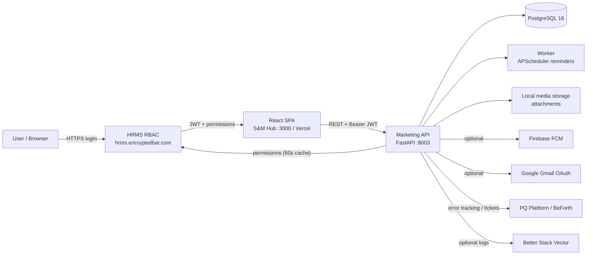

# S&M Hub

S&M Hub is the sales and marketing operations platform for **Aureole Group**. It manages the
end-to-end commercial pipeline — domains and regions, contacts, customers, organizations, leads,
quotations, orders, events, and daily reporting (DSR) — with role-based access and
row-level visibility enforced by the backend. Users sign in with their company (HRMS) account; the
system then shows only the leads, regions, and numbers their role is allowed to see.

The project is a React single-page app backed by a FastAPI service and a PostgreSQL database, with
authentication and permissions delegated to an external HRMS RBAC service.

## Key features

- **Lead pipeline** — kanban-style lead tracking with configurable statuses, status groups, types,
  activity logs, follow-up reminders, attachments, and "mark as won" flows.
- **Orders & quotations** — order pipeline mirroring the lead model, enquiry-to-quotation workflow,
  quote numbers from configurable numbering series, and DSR (daily sales report) enquiry logs.
- **Database (master data)** — organizations, customers, and contacts in a tabbed interface, with
  plants nested under organizations and a contact-to-customer conversion flow.
- **Domains & regions** — sales domains and regions with employee assignment, heads/coordinators,
  and reordering.
- **Events** — exhibition/event management with files, stall vendors, travel and gifting entries.
- **Reporting** — dashboard targets (per employee/region/domain), expected-order reports, OD (order
  disposition) plans, saved dashboards with custom SQL widgets, and report templates.
- **Administration** — numbering series, role scoping rules, marketing settings, audit logs, and
  an in-app "What's New" changelog.
- **Access control** — permission-based (RBAC) action gates *plus* row-level data scoping; support
  tickets and live activity (presence) views.
- **Notifications** — in-app notifications and optional web push (Firebase FCM).

## Tech stack

| Layer | Technology |
| --- | --- |
| Frontend | React 19, TypeScript 5.7, Vite 6, Tailwind CSS 3.4, Radix UI |
| Routing / state | react-router-dom 6, Redux Toolkit 2.5, Zustand 5 |
| Charts / animation | Recharts 2.15, Framer Motion 12, Lottie |
| Backend | Python 3.11, FastAPI 0.115, Uvicorn 0.32, SQLAlchemy 2.0, Pydantic 2.9 |
| Database | PostgreSQL 16 (Docker), Alembic scaffold (schema managed at startup) |
| Auth | External HRMS RBAC API (JWT issued by this API, 30-min expiry) |
| Background jobs | APScheduler (follow-up + event-travel reminders) |
| Push / integrations | Firebase FCM (optional), Google Gmail OAuth (optional), BeForth PQ Platform (error tracking + tickets), Better Stack Vector (optional logging) |
| Tests | Pytest (backend, smoke), Vitest (frontend, smoke) |
| Deploy | Docker Compose + Nginx (API, EC2 via GitHub Actions), Vercel (frontend) |

## Architecture at a glance



## Quick start

Two independent repos live side by side: the backend `au-marketing-api` and the frontend
`au-marketing-fe`. Clone each separately (they are separate git repositories).

```bash
# ── Backend (needs Docker + the .env from .env.example) ──
git clone <backend-repo-url> au-marketing-api
cd au-marketing-api
cp .env.example .env          # then edit DATABASE_URL / secrets
docker compose up --build -d  # runs db(:5435) + web(:8003) + worker + vector

# sanity check
curl http://localhost:8003/health

# ── Frontend (needs Node + npm; dev server on :3000) ──
git clone <frontend-repo-url> au-marketing-fe
cd au-marketing-fe
npm install
npm run dev                   # opens http://localhost:3000
```

Notes:

- The frontend calls the API at `http://localhost:8003` (set `VITE_API_BASE_URL` in
  `au-marketing-fe/.env` if your API is elsewhere).
- Login requires credentials from the external HRMS service
  (`https://hrms.encryptedbar.com/api/rbac`) — there is no local sign-up.
- The Docker `web` service maps container port 8000 to host port **8003**.

## Further reading

- [User Guide](./user-guide.md) — how to use the project, no code required.
- [Developer Guide](./developer-guide.md) — setup, architecture, and contribution details.
- [Architecture](./architecture.md) — diagram-first overview of how the system fits together.
- [Changelog](./changelog-template.md) — keep a record of releases (blank template).
